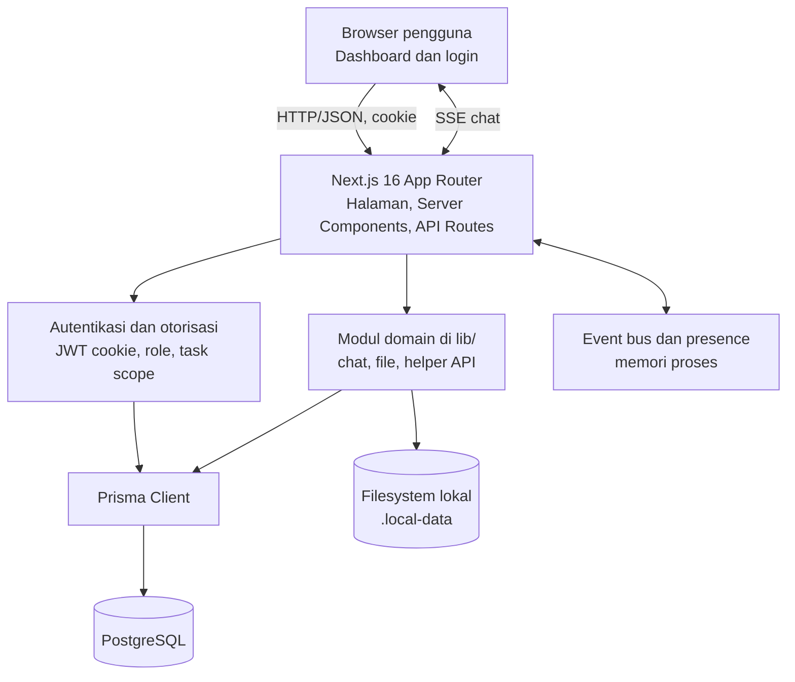
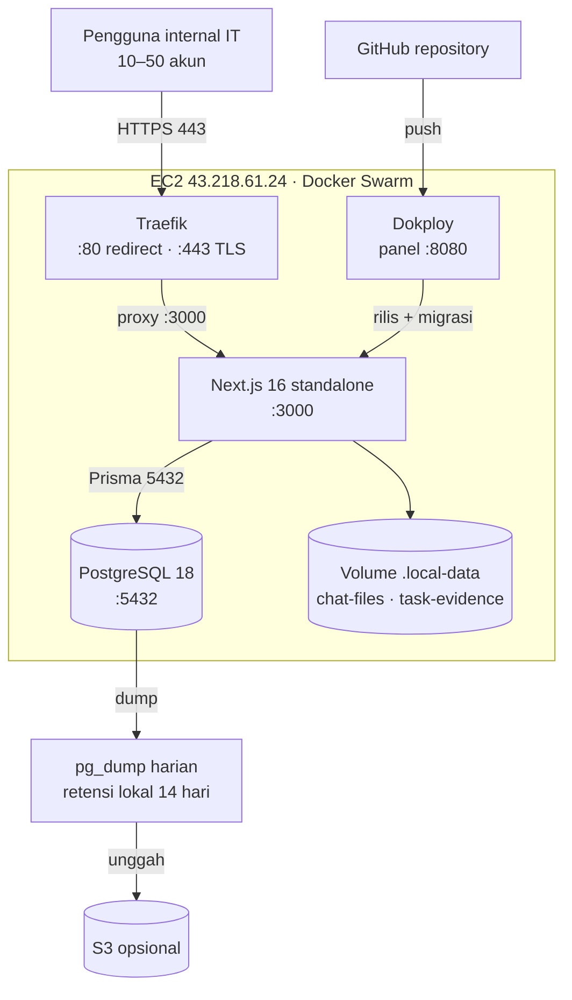
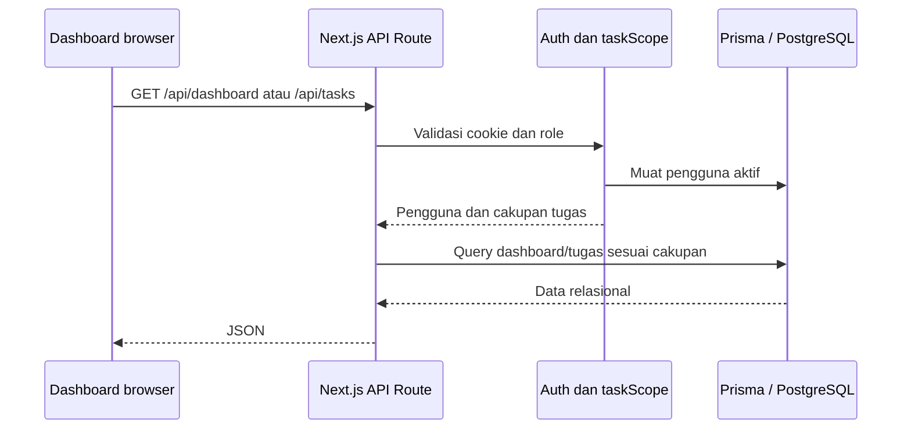
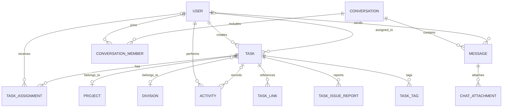

# Arsitektur REI Work Management

Dokumen ini menggambarkan arsitektur berdasarkan implementasi repository saat ini. Ini adalah aplikasi web monolitik: antarmuka, endpoint API, aturan akses, dan akses database berada dalam satu aplikasi Next.js.

## Gambaran sistem



## Komponen dan tanggung jawab

| Lapisan | Lokasi | Tanggung jawab |
| --- | --- | --- |
| Antarmuka | `app/page.tsx`, `app/login/page.tsx`, `components/dashboard/`, `components/` | Login dan dashboard modular; dashboard client mengambil data melalui API. Preferensi tema disimpan di browser. |
| Halaman server | `app/` | Next.js App Router merender halaman. Halaman utama memeriksa sesi dan mengarahkan pengguna tanpa sesi ke `/login`. |
| API | `app/api/**/route.ts` | Endpoint autentikasi, pengguna, proyek, tugas, dashboard, isu tugas, lampiran, dan chat. Route memvalidasi sesi, peran, input, dan cakupan data. |
| Logika bersama | `lib/` | Pemeriksaan sesi (`current-user.ts`), pembuatan JWT (`session.ts`), otorisasi dan task scope (`api.ts`), akses database, chat, presence, event, serta penyimpanan berkas. |
| Persistensi relasional | `prisma/schema.prisma`, `prisma/migrations/` | Model dan evolusi skema. Prisma Client dibuat ke `app/generated/prisma`. |
| Persistensi berkas | `.local-data/chat-files`, `.local-data/task-evidence` | Konten lampiran chat dan bukti isu tugas berada pada filesystem lokal; metadata tersimpan di PostgreSQL. |

## Topologi produksi (AWS + Dokploy)

Deployment berjalan pada satu node EC2 (`43.218.61.24`) dengan Docker Swarm dan Traefik sebagai reverse proxy. Hanya Traefik yang menghadap internet; aplikasi dan database berada di jaringan overlay internal `dokploy-network` tanpa port publik.



| Port | Layanan | Akses | Status |
| --- | --- | --- | --- |
| 80 | HTTP, redirect ke HTTPS | Internet | Buka |
| 443 | Traefik dan aplikasi | Internet | Buka |
| 22 | SSH server | IP admin saja | Batasi |
| 3000 | Next.js app | Internal Docker | Tutup dari internet |
| 5432 | PostgreSQL | Internal Docker | Tutup dari internet |
| 8080 | Panel Dokploy | Admin/VPN | Tutup dari internet |
| 2375, 2376 | Docker API | Internal host | Tutup dari internet |
| 2377, 7946, 4789 | Swarm control dan overlay | Antar node Swarm | Tutup dari internet |
| 9000, 10000 | Portainer/agen opsional | Internal | Tutup dari internet |

Trafik masuk mengikuti satu jalur: klien → Traefik 443 → container aplikasi 3000 → PostgreSQL 5432. Domain `work-management.lmrei.id` menunjuk ke alamat publik EC2, dan sertifikat TLS diperbarui Traefik secara otomatis. Security group hanya mengizinkan 80/443 dari mana saja serta 22 dari IP admin; aturan penutupan port dan skripnya ada di `README.md` bagian "Port AWS: yang dibuka dan ditutup".

## Alur permintaan

### Login dan sesi

1. Browser mengirim email dan kata sandi ke `POST /api/auth/login`.
2. Server memeriksa kredensial pengguna dan membuat token JWT bertanda tangan HS256.
3. Token disimpan sebagai cookie `httpOnly` bernama `token` dengan masa berlaku tujuh hari.
4. Pada permintaan berikutnya, `getCurrentUser()` memverifikasi token, mengambil pengguna aktif melalui Prisma, lalu mengembalikan identitas dan konteks divisi.
5. API memakai `authorize()` untuk menolak sesi yang tidak valid dan membatasi aksi berdasarkan role.
6. Penghapusan anggota tim adalah soft delete (`isActive = false`) khusus `SUPER_ADMIN`/`ADMIN`. Karena `getCurrentUser()` hanya menerima pengguna aktif, sesi anggota yang dihapus langsung tidak berlaku; relasi tugas dan riwayat chat tetap tersimpan.
7. Setiap pengguna dapat mengganti kata sandi sendiri melalui `PATCH /api/auth/password`. Kata sandi lama diverifikasi dengan bcrypt sebelum hash baru disimpan; sesi JWT yang sedang aktif tetap berlaku karena token tidak menyimpan kata sandi.
8. Penghapusan proyek bersifat soft delete (`isActive = false`), sedangkan penghapusan tugas bersifat permanen dan ikut menghapus tautan serta bukti isu. Keduanya dibatasi untuk `SUPER_ADMIN` dan `ADMIN`.

### Data dashboard dan tugas



`SUPER_ADMIN`, `ADMIN`, dan `MANAGER` mendapat cakupan tugas global menurut `taskScope()`. Pengguna lain mendapat tugas yang ditugaskan, dibuat, dialokasikan, atau menandai mereka; `SPV` juga dapat melihat tugas pada divisi terkait. Pemeriksaan role untuk aksi tulis dilakukan per route melalui daftar seperti `ADMIN_ROLES` dan `MANAGE_ROLES`.

### Chat waktu nyata

- Riwayat percakapan, anggota, pesan, dan metadata lampiran disimpan di PostgreSQL.
- Browser membuka `GET /api/chat/stream` menggunakan Server-Sent Events (SSE). Route memeriksa sesi dan mengirim event yang dipublikasikan selama koneksi aktif.
- `lib/chat-events.ts` menggunakan `EventEmitter` dalam memori proses untuk menyebarkan pesan, percakapan, dan presence.
- Status koneksi/online disimpan dalam map di memori proses oleh `lib/chat-presence.ts`.

### Lampiran dan bukti isu

- Bukti isu tugas hanya menerima JPG, PNG, WebP, atau PDF, maksimum 10 MB, dengan pemeriksaan signature konten. File disimpan di `.local-data/task-evidence`; metadata dan relasinya dicatat di PostgreSQL.
- Lampiran chat disimpan di `.local-data/chat-files`, maksimum 50 MB per file dan 10 file per pesan. Metadata file tersimpan di PostgreSQL.
- Endpoint unduh memeriksa autentikasi dan otorisasi sebelum mengirim konten.

## Model data utama



Entitas inti mencakup pengguna dan divisi; proyek dan tugas; assignment, tag, tautan, laporan isu, dan aktivitas tugas; serta percakapan, anggota, pesan, dan lampiran chat. Enum Prisma mengatur role, status/prioritas tugas, jenis percakapan, serta status chat.

## Batas deployment yang perlu diperhatikan

- Event bus SSE dan presence memakai memori satu proses. Beberapa instance aplikasi tidak berbagi event maupun status online; deployment multi-instance perlu broker bersama, seperti Redis atau PostgreSQL `LISTEN/NOTIFY`.
- Lampiran memakai filesystem lokal. Deployment dengan filesystem sementara atau beberapa instance memerlukan volume persisten bersama atau object storage, dan strategi pencadangan.
- Build mengaktifkan `output: "standalone"` agar hasil runtime Next.js lebih ringkas. Untuk menjalankan server standalone, sertakan folder `public/` dan `.next/static/` pada paket runtime; lihat langkah AWS di `README.md`.
- PostgreSQL adalah sumber data utama untuk data aplikasi dan metadata file. `DATABASE_URL` dan `JWT_SECRET` disediakan melalui environment; jangan masukkan secret ke repository.
- Untuk skala 10–50 pengguna, `connection_limit=5` per instance sudah memadai; PgBouncer baru dipertimbangkan mendekati 1.000 pengguna bersamaan.
- `scripts/backup-database.mjs` menjadwalkan dump harian (`pg_dump` custom format) dengan retensi lokal dan unggah S3 opsional. Lampiran di `.local-data` harus dicadangkan terpisah karena tidak termasuk dump database.
- Jalankan migrasi Prisma saat deployment sebelum aplikasi melayani trafik.

## Peta repository

```text
app/
  api/                 Route API (auth, users, projects, tasks, dashboard, chat)
  login/               Halaman login
  page.tsx             Gerbang halaman dashboard
  components/dashboard/  Dashboard, chat, tugas, dan komponen antarmuka
components/            Komponen antarmuka bersama
lib/                   Sesi, otorisasi, Prisma, chat, dan utilitas berkas
prisma/                Schema dan migrasi database
scripts/               Utilitas administrasi akun
.local-data/            Berkas lokal runtime (tidak untuk sumber kebenaran lintas instance)
```
